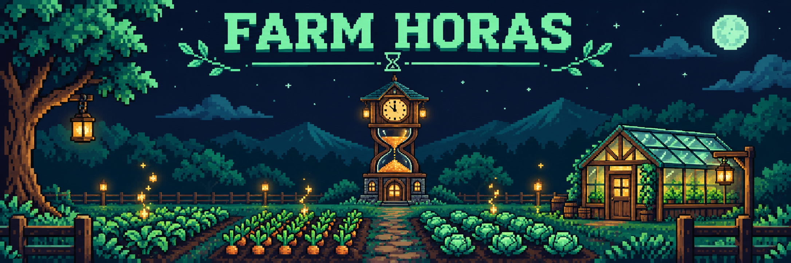

<p align="center">
  
</p>

# Farm Horas

Gerencie sessões Steam por AppID no Windows, sem baixar os jogos. Inicie sua lista de uma vez, acompanhe as horas por jogo e use o ajuste fino perto da meta de **3.333 horas**.

<p align="center">
  <a href="#como-compilar">Compilar no Windows</a> ·
  <a href="#como-usar">Como usar</a> ·
  <a href="#proteção-de-horas">Proteção de horas</a>
</p>

<p align="center">
  
</p>

<p align="center"><sub>Animação ilustrativa do contador, com tempo acelerado.</sub></p>

## Como usar

1. Abra a Steam e entre na sua conta.
2. [Compile o projeto](#como-compilar), abra `Release/Atualizado/FarmHoras.exe` e mantenha `steam_api64.dll` na mesma pasta.
3. Cole os AppIDs separados por vírgulas, espaços ou linhas e clique em **Adicionar à lista**. O AppID é o número após `/app/` na página do jogo na Steam. Os IDs ficam na tabela **Jogos salvos** nas próximas aberturas. A lista também recupera os IDs da versão anterior que estiverem no arquivo de AppIDs ou no histórico de sessões iniciadas.
4. Clique em **Iniciar todos** para abrir as sessões disponíveis na lista de uma vez. Você também pode iniciar pela linha de cada jogo ou selecionar vários com Ctrl e clicar em **Iniciar selecionados**. Para cadastrar e começar em um passo, use **Adicionar e iniciar**. A tabela mostra quantos jogos foram adicionados e quantas sessões estão ativas. Use **Remover da lista** para tirar os jogos selecionados com a sessão parada.
5. Acompanhe o tempo da sessão e as horas acumuladas na coluna **Total na Steam**. Ao detectar **3.333 horas** ou mais para um jogo, o Farm Horas encerra a sessão desse AppID e o remove de **Jogos salvos**. A regra também vale para jogos que já estavam na meta quando foram carregados.
6. Clique em **Parar** para encerrar uma sessão manualmente ou em **Parar todas** para encerrar todas. Fechar o Farm Horas também encerra as sessões.

Use AppIDs de jogos disponíveis na sua conta. O Farm Horas consulta a cada 15 segundos o total acumulado que o cliente Steam gravou no computador. A atualização depende de quando a Steam sincroniza esses dados. A coluna exibe **—** enquanto o total estiver indisponível. A lista de AppIDs e o log ficam em `%LOCALAPPDATA%\FarmHoras`.

## Proteção de horas

O programa faz a primeira parada com **30 minutos de margem** antes da meta. Ele preserva o tempo medido localmente entre rodadas e reaberturas. Se não puder ler o total do jogo ou gravar a proteção, ele bloqueia novas sessões. Se o encerramento de uma sessão ficar sem confirmação, a reserva de tempo continua gravada e o jogo fica bloqueado.

Após a primeira parada, espere a Steam atualizar o total. Quando o botão **Ajuste fino** aparecer na linha do jogo, clique nele para iniciar uma rodada de até **2 minutos**, sem instalar o jogo. As rodadas de ajuste fino são iniciadas pela linha de cada jogo. O Farm Horas relê o total após fechar a sessão e aguarda um valor maior da Steam antes de liberar outra rodada. Quando houver menos de 70 segundos disponíveis até a última margem estimada de **3.332 h 59 min**, a ação fica em **Sem folga**.

A coluna **Total na Steam** mostra a última leitura do cliente. **Estimativa** inclui o tempo medido localmente pelo Farm Horas durante a sessão. **Até 3.333 h** conta quanto falta para a meta estimada. **Até a parada** conta quanto falta para o limite de segurança. As duas contagens usam horas, minutos e segundos.

A Steam controla o total oficial e pode sincronizar com atraso. O ajuste fino pode aproximar o jogo da meta com menos tempo de sobra. Horas feitas fora do Farm Horas ou ainda ausentes do total lido podem afetar o resultado. O jogo só sai da lista quando a Steam informa **3.333 horas ou mais**.

## Como compilar

Requer Windows 10 ou 11 de 64 bits com .NET Framework 4.8.

1. Baixe ou clone este repositório.
2. Crie a pasta `Dependencies` na raiz e coloque nela a biblioteca `steam_api64.dll` de 64 bits, disponível em `redistributable_bin/win64` no SDK. O código-fonte é distribuído separadamente da biblioteca da Valve. [Documentação do Steamworks SDK](https://partner.steamgames.com/doc/sdk).
3. Na raiz, execute o script com o PowerShell. Ele usa o compilador do .NET Framework instalado no Windows.

```powershell
powershell.exe -NoProfile -ExecutionPolicy Bypass -File .\build.ps1 -OutputDirectory .\Release\Atualizado
```

O executável e a biblioteca Steamworks ficam em `Release\Atualizado`.

## Arte do projeto

A capa em pixel art e o GIF ficam em [`assets/`](assets/). Para gerar novamente o contador, execute `python tools/render-counter.py` em um ambiente com Pillow.

## Referências

- Projeto de referência [BDK Steam Hour Farm](https://github.com/arthurqui/BDK-Steam-Hour-Farm).
- A versão da biblioteca usada no build local é a [DLL Steamworks do projeto de referência](https://github.com/arthurqui/BDK-Steam-Hour-Farm/blob/main/Dependencies/steam_api64.dll), assinada pela Valve.
